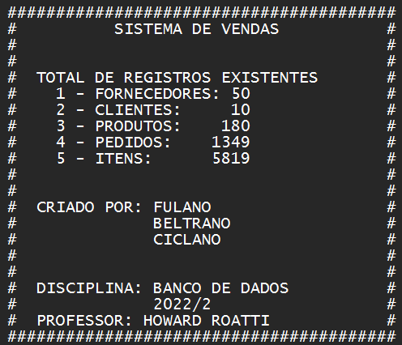
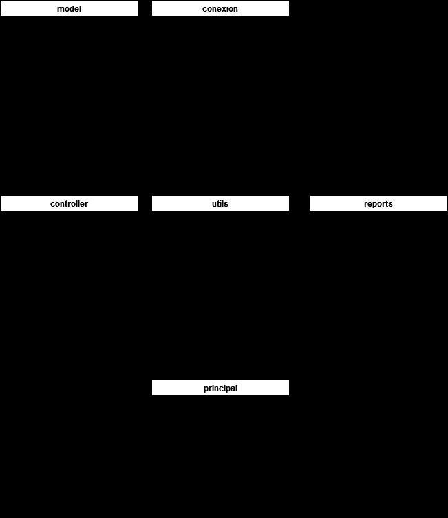

# C3_Edital_Desenvolvimento_Banco_Não_Relacional_-_Valor_8_Pontos_-_Grupo

**Arquivo original:** `C3_Edital_Desenvolvimento_Banco_Não_Relacional_-_Valor_8_Pontos_-_Grupo.pdf`  
**Total de páginas:** 13

---

## Página 1

Projeto de Desenvolvimento de uma Aplicação Simulando um Sistema Real de 
Interface entre Uma Linguagem de Programação e o Banco de Dados 
MongoDB 
Disciplina: Banco de Dados 
Professor: Howard Roatti 
Última Atualização: 05/10/2026 
- Incluído(s): Semestre 2026/2 e data de entrega do trabalho. 
- Itens Atualizados: Item 0 (datas) e Última Atualização. 
 
Sumário 
Edital: .......................................................................................................................... 2 
ESQUEMA DO PROJETO NO GITHUB ..................................................................... 8 
FAQ ............................................................................................................................. 9 
ROTEIRO PARA AUXÍLIO NA EXECUÇÃO DO TRABALHO................................... 10 
Orientações para Desenvolvimento do Projeto: ........................................................ 11

---

## Página 2

Edital: 
 
0 - Sobre a formação dos grupos: conforme explicado em sala de aula, a formação 
dos grupos será a mesma da C2, exceto se houve algum comunicado referente à 
Observação do item 8 - Distribuição da Pontuação do edital da C2. A entrega final 
deste trabalho deverá ser feita no AVA até 04/12/2026 (semestre 2026/2). 
• 
No caso de algum componente referenciado na C2 como não contribuiu para o 
desenvolvimento do trabalho, esse será remanejado para um novo grupo escolhido 
aleatoriamente. 
1 - Sobre o tema para a esse trabalho: dê preferência para reutilizar o mesmo 
projeto da C2, assim você terá apenas que modificar os trechos do seu código que 
envolve a linguagem SQL, alterando para a sintaxe do banco de dados não 
relacional MongoDB. 
• 
Caso opte em criar um projeto novo, você ainda não poderá selecionar como tema o 
mesmo do projeto de exemplo. 
2 - A aplicação deve possuir no mínimo 2 (duas) coleções com relacionamentos 
3 - Desenvolvam o diagrama relacional, especificando os atributos, chaves, 
obrigatoriedade e relacionamentos (perceba que o diagrama é para um banco de 
dados relacional, independente de estarmos tratando de um banco de dados não 
relacional nesse trabalho) 
4 - Caso decida por manter o trabalho da C2, você deverá desenvolver um script que 
seja capaz de (Vide Exemplo): 
I. 
Conectar ao banco de dados relacional Oracle 
II. 
Consultar cada uma das tabelas existentes referente ao projeto da C2 
III. 
Conectar ao banco de dados não relacional (NoSQL) MongoDB 
IV. 
Criar uma coleção com o mesmo nome de cada tabela existente no projeto da C2 
V. 
Caso seu projeto da C2 possua registros pré-cadastrados, realize a criação dos 
documentos nas referidas coleções 
5 - Caso optem pelo desenvolvimento de um novo projeto, você deverá desenvolver 
um script que seja capaz de:

---

## Página 3

I. 
Conectar ao banco de dados não relacional (NoSQL) MongoDB 
II. 
Criar coleções referentes às tabelas contidas no diagrama relacional 
6 – Crie um programa na linguagem de sua preferência que: 
a) Possua um menu com as seguintes opções: 
i. relatórios 
ii. inserir documentos 
iii. remover documentos 
iv. atualizar documentos 
v. sair  
b) Obs.: O menu pode ser personalizado, desde que atenda aos requisitos 
listados acima; 
c) Ao iniciar, seu programa deverá exibir o nome da aplicação e os nomes dos 
componentes do grupo (Splash Screen) 
d) Ao iniciar, seu programa deverá informar se as coleções possuem 
documentos, para isso execute uma consulta que seja capaz de contar o 
número de documentos 
e) Exemplo de tela de inicialização: 
 
f) O menu principal deverá ser exibido constantemente, de acordo com o fluxo 
de execução projeto

### Imagens da Página 3

  
*pagina_03_img_01.png (496x426px)*

---

## Página 4

g) Ao criar submenus, durante a utilização deles, deverão ser exibidos 
constantemente de acordo com o fluxo de execução 
7 - Descrição das funcionalidades dos itens de menu: 
    a) relatórios: 
       (1) deve haver ao menos duas opções de relatórios: 
            (i) consulta realizando a sumarização (agrupamento) de alguma(s) coleção, 
por exemplo: o valor total dos pedidos agrupados por fornecedores. 
           (ii) uma consulta com junção de coleções, por exemplo: relatório de itens de 
pedido. 
    b) inserir documentos: 
       (1) deverá exibir um menu com as opções das entidades existentes 
       (2) o usuário deverá selecionar uma das entidades 
       (3) exiba cada atributo da entidade selecionada e permita que o usuário informe 
os dados delas 
       (4) realize a inserção do documento 
       (5) pergunte ao usuário se deseja continuar inserindo, caso a resposta seja 
"Não", volte ao menu principal. Caso a resposta seja "Sim", volte ao menu de opções 
de entidades existentes ou permita que continue realizando a ação na entidade 
previamente selecionada. 
    c) remover documentos: 
       (1) deverá exibir um menu com as opções das entidades existentes 
       (2) o usuário deverá selecionar uma das entidades 
       (3) deverá listar as tuplas (documentos) da entidade (coleção) selecionada, ao 
menos o campo principal e um campo descritivo

---

## Página 5

(4) o usuário deverá selecionar o documento que deseja remover através de 
uma opção (campo principal ou listagem numérica fixa, por exemplo) 
       (5) confirme com o usuário se deseja realmente remover o registro, caso a 
resposta seja "Não", volte ao menu principal. Caso a resposta seja "Sim": 
           (i) verifique se o documento que o usuário deseja alterar possui algum 
documento referenciado em outra coleção, caso possua: informe que aquele 
documento não poderá ser excluído ou pergunte se é desejo dele remover o 
documento da coleção filha, excluindo-as caso a resposta seja "Sim". 
     (6) pergunte ao usuário se deseja excluir mais algum documento, caso a resposta 
seja "Não", volte ao menu principal. Caso a resposta seja "Sim", volte ao menu de 
opções de entidades existentes ou permita que continue realizando a ação na 
entidade previamente selecionada. 
    d) atualizar documentos:  
       (1) deverá exibir um menu com as opções das entidades existentes 
       (2) o usuário deverá selecionar uma das entidades 
       (3) deverá listar as tuplas (documentos) da entidade (coleção) selecionada, ao 
menos o campo principal e um campo descritivo 
       (4) o usuário irá selecionar a tupla que deseja atualizar através de uma opção 
(campo principal ou listagem numérica fixa, por exemplo) 
       (5) solicite que ele informe todos os atributos atômicos, exceto o campo principal 
ou permita que ele escolha qual campo deseja alterar 
       (6) realize a atualização da tupla com os dados informados pelo usuário 
       (7) exiba o registro atualizado 
       (8) pergunte ao usuário se deseja atualizar mais algum documento, caso a 
resposta seja "Não", volte ao menu principal. Caso a resposta seja "Sim", volte ao 
menu de opções de entidades existentes ou permita que continue realizando a ação 
na entidade previamente selecionada.

---

## Página 6

8 - Entregáveis: 
    (a) Todos os scripts deverão estar disponíveis no Github do grupo em um novo 
projeto 
            (i) script de criação das coleções 
           (ii) código fonte do programa desenvolvido, devidamente organizado 
          (iii) diagrama relacional (pdf, png ou jpeg) 
           (iv) vídeo demonstrativo das funcionalidades implementadas, explicando o 
passo a passo da aplicação 
 
(v) README.MD explicando como executar o projeto no ambiente proposto 
(Linux) 
    (b) Deverá ser postado no AVA o link para o Github. A participação de cada 
membro será avaliada pelo número de commits no repositório (ver Observações).  
    (c) Somente será corrigido se seguir as orientações do edital, caso contrário é 
zero! 
9 - Distribuição da Pontuação: 
Nota 
Item 
Item Específico 
1,5 
Relatórios 
1.0 <7.a.1.i> e 0.5 <7.a.1.ii> 
1,5 
Inserir Registros 
1.0 <7.b.[1-4]> e 0.5 <7.b.5> 
1,5 
Remover Registros 
1.0 <7.c.[1-4 e 6]> e 0.5 <7.c.5.i> 
1,5 
Atualizar Registros 
1.0 <7.d.[1-6]> e 0.5<7.d.[7-8]> 
0,5 
Diagrama Relacional, corretamente desenvolvido. 
0,5 
Interface Amigável. 
 
Obs.: não é obrigatória a criação de telas ou páginas, mesmo no 
console é possível ter uma interface amigável. 
0,5 
Vídeo Demonstrativo no YouTube explicando o objetivo do trabalho 
e a utilização do sistema passo a passo em todos os menus. Não 
há necessidade alguma de explicar o código, apenas o 
funcionamento do sistema. Todos os menus devem ser exibidos no 
vídeo em funcionamento. 
0,5 
Documentação explicativa de utilização do sistema no Linux no 
README.MD do repositório no GitHub. 
8,0 
Total

---

## Página 7

Observações Importantes:  
(1) todos os componentes do grupo deverão participar de sua criação. A participação 
de cada membro será medida pelo número de commits no repositório GitHub do trabalho; 
o(a) aluno(a) que não registrar commits (contribuição efetiva) terá sua avaliação individual 
zerada automaticamente.  
(2) lembre-se que trabalho não possui avaliação substitutiva.  
(3) atrasos serão tolerados, porém, perderão 0,5 pontos a cada dia de atraso. 
(4) o banco de dados deverá ser o MongoDB 
(5) Uso de IA: é permitido utilizar ferramentas de IA (ex.: ChatGPT e outros LLMs) 
como apoio ao desenvolvimento, desde que com transparência. Todo prompt utilizado 
deverá ser versionado no repositório, em um arquivo PROMPTS.md (registrando o prompt, 
a fonte e o que o grupo fez com a resposta). Entregar código que o grupo não saiba explicar 
implica em perda de pontos. 
(6) O repositório no GitHub deverá ter o professor adicionado como colaborador 
(usuário: howardroatti), para que seja possível avaliar o funcionamento do trabalho e a 
participação de cada membro (pelos commits). 
(7) O trabalho deverá ser executável na máquina virtual (VM) da disciplina, 
garantindo que todos sigam o mesmo ambiente e que a avaliação seja coerente. 
10 - Projeto de Exemplo: https://github.com/howardroatti/example_crud_mongo  
    (a) façam um fork (cópia) do projeto e analise o projeto antes de iniciar o de vocês 
    (b) não deixem para fazer em cima da hora, o projeto é extenso e vocês podem 
não ter tempo hábil de realizá-lo, principalmente se for realizar um novo projeto e 
não optar por dar continuidade ao anterior (C2) 
    (c) não serão aceitos projetos idênticos ou cópias parciais, exceto do projeto de 
exemplo

---

## Página 8

ESQUEMA DO PROJETO NO GITHUB

### Imagens da Página 8

  
*pagina_08_img_01.png (651x752px)*

---

## Página 9

FAQ  
   Podemos criar interface gráfica?  
         Sim 
   Podemos manter o programa apenas no console sem interface gráfica?  
         Sim, desde que tenha uma interface amigável e seja de fácil utilização. 
   Podemos utilizar uma linguagem diferente?  
         Sim, a linguagem que vocês se sentirem mais confortáveis, porém, seu projeto 
deve ser capaz de ser executado em um ambiente Linux 
   Podemos usar algum componente, biblioteca ou funcionalidade que facilite a 
criação de consultas e alterações das coleções do banco de dados? 
         Não, você deverá criar as consultas e atualizações utilizando a linguagem 
nativa, apenas com uma biblioteca que permita a execução de comandos MongoDB. 
 Podemos realizar o trabalho sem grupos? 
         Prioritariamente, o trabalho deverá ser desenvolvido em grupo. É importante 
que aprendam a trabalhar em equipe e designar tarefas. Entretanto, é possível a 
realização do trabalho individualmente, desde que o aluno se responsabilize por 
desenvolver o projeto e entregar em tempo hábil para sua correção, não deixando 
para informar na semana de entrega a necessidade de realizar a atividade solo. 
É possível trocar de grupo? 
 
A troca de grupo será permitida até duas semanas antes da data de entrega, 
para que o aluno seja capaz de contribuir com o desenvolvimento da atividade 
proposta. Caso seja interesse do aluno, esse deverá procurar um grupo disponível 
que aceite sua entrada e informar ao professor para realizar a alteração no sistema.

---

## Página 10

ROTEIRO PARA AUXÍLIO NA EXECUÇÃO DO TRABALHO 
1 - Crie o modelo com o Mermaid (diagrama como código) 
2 - Gere um PDF com o modelo proposto 
3 - Gere o script de criação das coleções 
4 - Criem os objetos relacionados às entidades do modelo proposto 
5 - Criem as classes controladoras para cada objeto do modelo proposto 
6 - Criem os relatórios solicitados no edital 
7 - Altere o splash_screen 
8 - Altere a classe principal

---

## Página 11

Orientações para Desenvolvimento do Projeto: 
 
Etapa 1: Modelagem e Criação de Coleções 
- Defina quais serão as entidades e seus atributos; 
- Lembre-se de definir corretamente os nomes dos campos (nome único por tabela); 
- Lembre-se de definir corretamente o tipo de cada campo (inteiro, real, texto, data, 
etc); 
- Lembre-se de definir os campos determinantes (PK e FK); 
- Crie o diagrama relacional com as tabelas, campos, tipos, chave primária, chave 
estrangeira e relacionamentos com as devidas cardinalidades; 
- Gere o script para criação das coleções; 
Etapa 2: Criação das Classes Principais 
- Desenvolva as classes que representam as tabelas do tema que estão 
trabalhando, utilize os exemplos em src/model; 
- Lembre-se que sempre que um objeto possui uma associação com outro, a classe 
deverá ter como atributo uma instância do outro objeto, não apenas seu atributo. 
Olhe os exemplos: src/model/itens_pedido.py e src/model/pedidos.py; 
- Lembre-se de criar os getters e setters para cada atributo; 
- Lembre-se de criar um método to_string para cada classe; 
Etapa 3: Criação das Classes Controladoras 
- Desenvolva as classes que irão realizar a interface entre os objetos da Etapa 2 e 
as tabelas da Etapa 1; 
- Lembre-se de criar um método de verificação de existência ou não do registro que 
está trabalhando. Sendo um novo (Inserção), ele não deve existir, para que possa

---

## Página 12

ser criado e então mantemos a integridade de entidade. Sendo um registro existente 
(Atualização ou Exclusão), ele deve existir, para que possa realizar o procedimento; 
- Lembre-se de, em cada interface, realizar a conexão antes de efetuar a execução 
dos comandos MongoDB; 
- Lembre-se de realizar a concatenação dos atributos quando necessário; 
- Veja os exemplos existentes, para criar o seu. Eles se encontram em: 
src/controller; 
- Realize os testes de cada detalhe que irá criar, para saber se está funcionando 
corretamente; 
Etapa 4: Criação dos Relatórios 
- Junto do seu grupo, definam os relatórios que irão criar para atender ao edital. 
Lembre-se que, obrigatoriamente, deverão ter dois relatórios: um com funções 
agregadas e cláusula group by (sumarização) e outro com joins (junção de 
coleções); 
- Caso seja necessário exibir informações das coleções no formato de listagem, 
como no exemplo da controladora de Itens de Pedidos e da controladora de 
Pedidos, crie as consultas no formato de relatório; 
- Altere a classe src/reports/relatorios.py para que ela seja capaz de exibir os 
relatórios que criou e executar as consultas de cada relatório; 
Etapa 5: Splash Screen e Menus 
- Altere e/ou inclua no arquivo src/utils/config.py os menus de relatórios, entidades e 
algum outro que queira inserir; 
- Altere os atributos da classe src/utils/splash_screen.py para que apareça o nome 
do sistema proposto, a quantidade de registros em cada coleção, os nomes dos 
componentes do grupo e preserve o nome do professor, disciplina e semestre; 
Etapa 6: Principal

---

## Página 13

- Altere as interfaces existentes (métodos inserir, atualizar, excluir e reports) para 
atender ao sistema proposto; 
- Lembre-se de que no sistema proposto não há a necessidade de ter mais do que 
duas entidades/tabelas; 
- Lembre-se de verificar se todos os imports estão adequados ao que criou; 
- Lembre-se de alterar os fluxos de menus para atender ao edital, no exemplo 
existem partes que não foram implementadas que podem afetar o resultado do 
trabalho; 
Etapa Final: 
- Estude o projeto de exemplo, é importante que tirem todas as dúvidas durante o 
desenvolvimento do trabalho; 
- Respeite a Orientação a Objetos e a utilize corretamente; 
- Respeite a criação e utilização dos comandos MongoDB. Use adequadamente; 
- Realize diversos testes: peça cada componente do grupo que teste, peça pessoas 
de fora do grupo para testar; 
- Estabeleçam metas semanais para execução do trabalho. Lembre-se que o tempo 
é curto; 
- Lembre-se de gravar o vídeo demonstrando a utilização do sistema proposto; 
- Lembre-se de manter o GitHub atualizado até o dia da entrega;

---
